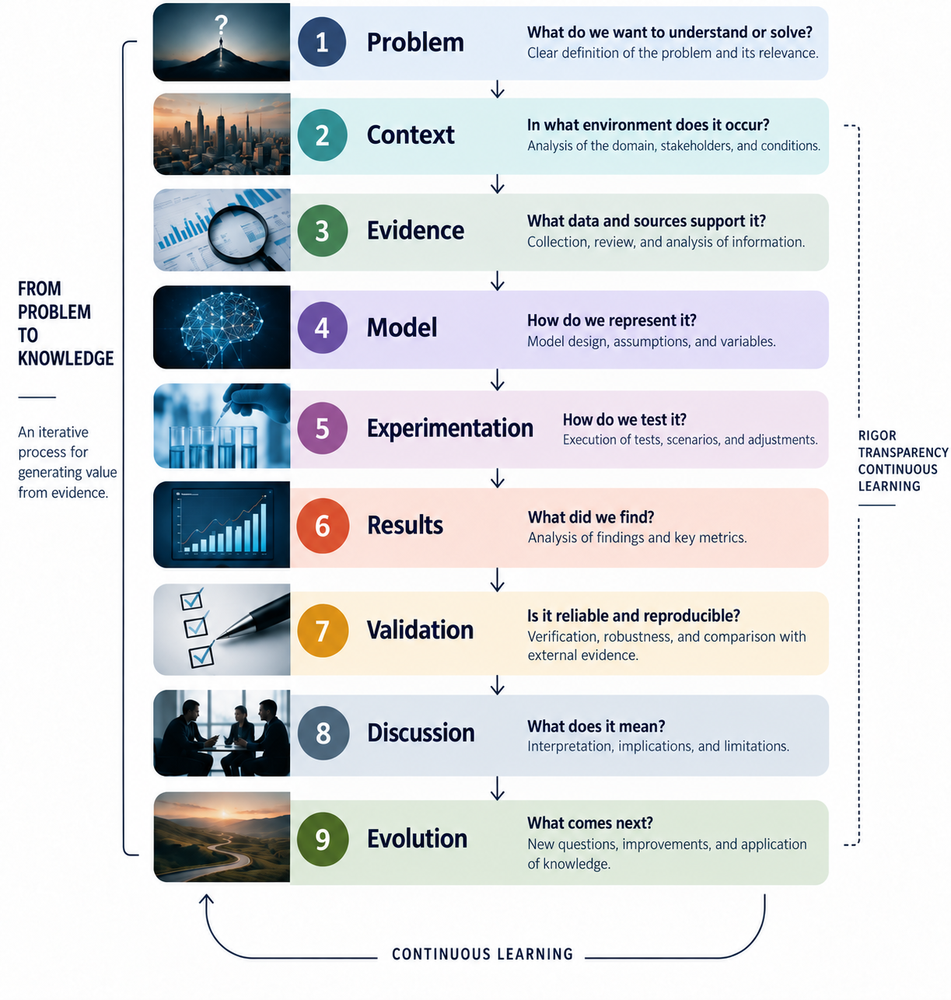

# Sidhartha Research

### Research · Engineering · Modeling · Data

[](https://sidhartha-research.com/)
[](https://pages.github.com/)
[](https://sidhartha-research.com/)

<p align="right">
  <a href="README.md">🇪🇸 Español</a> · <a href="README.en.md">🇬🇧 English</a>
</p>

**Sidhartha Research** is a personal research platform focused on studying complex problems through engineering, data, modeling, simulation, quantitative analysis, and interdisciplinary collaboration.

The website serves as the public-facing layer for this work. It presents each problem, its context, evidence, models, results, and open questions, while code, data, and other technical resources can live in specialized repositories or artifacts.

> **Research does not end when it is published.**

Each project can evolve in response to new evidence, expert review, experimentation, contributions from others, or new research questions.

---

## Website

**Sidhartha Research**

https://sidhartha-research.com/

The website brings together published and ongoing work, providing an accessible interface for technical audiences and specialists across different fields.

The goal is for readers to understand the problem and evaluate the work **without having to start by reading the source code**.

---

## Purpose

Sidhartha Research begins with a simple idea:

> Complex problems rarely belong to a single discipline.

An engineering model may need medical knowledge.

A financial analysis may require discussion of its assumptions.

Social research can benefit from quantitative methods.

A computational system may need validation by specialists in the domain it represents.

For this reason, the work published here aims to make the different layers of the research process visible:

<p align="center">
  
</p>

Not every project follows exactly the same stages. The methodology is adapted to the problem, the available evidence, and the project's stage of development.

---

## Projects

### 01 · Engineering & the Future of Work

Research · Engineering · Work · AI

A study of changes in Mexico's engineering labor market and how professional capabilities may evolve through 2030. The publication brings together research, evidence, quantitative analysis, visualizations, methodology, references, and interactive tools.

Publication:

🔗 **[Engineering & the Future of Work](https://sidhartha-research.com/research/employment_trends/)**

### 02 · Emergency Department Simulation

Research · Healthcare · Simulation · Modeling

A project studying care processes in an emergency department through discrete-event simulation. It aims to represent operational processes, resources, patient flow, and experimental scenarios, then validate the model's assumptions and rules through interdisciplinary review.

Status: In development.

Publication:

🔗 **[Emergency Department Simulation](https://sidhartha-research.com/projects/emergency-simulation/emergency_simulation/frontend/index.html)**

### 03 · Comparative Analysis of Artificial Intelligence Tools

Research · Engineering · Work · AI

Research into how incorporating artificial intelligence (AI) tools into information analysis is changing the way organizations process documents, interpret data, and produce findings for decision-making.

Status: Research · Data collection.

Publication:

🔗 **[AI Tools Comparison](https://sidhartha-research.com/research/ia_tools_analysis/index.html)**

### 04 · Hedge Fund

Finance · Data · Quantitative analysis · Experimentation

A quantitative research project focused on financial data, modeling, experimentation, and strategy development.

Status: In development.

## Repository Architecture

The repository serves as the main publishing layer for Sidhartha Research.

```text
sidhartha-research/
│
├── index.html
│
├── research/
│   └── employment_trends/
│       ├── index.html
│       ├── research.html
│       ├── dashboard.html
│       ├── data.html
│       ├── engineer2030.html
│       ├── methodology.html
│       ├── references.html
│       ├── 404.html
│       ├── favicon.svg
│       │
│       └── assets/
│           └── figures/
│
├── README.md
├── README.en.md
└── .gitignore
```

### Publishing layer

Contains the main website and the web publications that are part of Sidhartha Research.

### Research layer

Each project can have its own structure, methodology, resources, and artifacts.

### Technical layer

Simulation code, analyses, models, and other specialized components can live in separate repositories. This lets domain specialists understand a publication without requiring them to navigate the technical implementation directly.

---

## Interdisciplinary Research

One of Sidhartha Research's main purposes is to make it easier for people with specialized knowledge of a field to review work related to that field. Collaboration can take place at different levels:

| Field | Possible contribution |
| --- | --- |
| Healthcare | Validation of processes, rules, and assumptions |
| Finance | Review of assumptions, models, and strategies |
| Engineering | Modeling, processes, and technical validation |
| Social sciences | Research design, participation, and interpretation |
| Data | Methodology, analysis, and reproducibility |
| Technology | Implementation, architecture, and experimentation |

The goal is not to replace specialized knowledge with software. It is to make that knowledge part of the modeling and validation process.

---

## Principles

1. **Publication is a communication layer.** The website does not replace code, data, or models; it makes them accessible to different audiences.
2. **Code is not the whole of the research.** An implementation may be technically correct yet misrepresent the phenomenon it seeks to study. Context, rules, assumptions, and validation are essential parts of the work.
3. **Models can be questioned.** Published models should be open to discussion and review, and changed when needed.
4. **Evidence comes before conclusions.** Claims should have an explicit connection to the data, sources, assumptions, or methods that support them.
5. **Projects evolve.** A publication represents the state of a project at a particular point in time. New evidence can lead to new versions, experiments, or questions.

---

## Technology

The platform uses standard web technologies for its publishing layer:

* HTML
* CSS
* JavaScript
* Git
* GitHub
* GitHub Pages

Individual projects may use different technologies depending on their needs, including tools for:

* data analysis
* simulation
* statistics
* machine learning
* modeling
* visualization
* quantitative research

The technologies used by each project are documented in its own context.

---

### Local Development

The repository is designed for local development and can then be published through GitHub Pages.

Clone the repository:

```bash
git clone https://github.com/SidharthaManriquez44/sidhartha-research.git
cd sidhartha-research
```

Any environment that supports HTML, CSS, and JavaScript can be used for development and editing.

---

## Author

Sidhartha Manríquez González

Engineering · Data · Modeling · Applied Research

GitHub:  
https://github.com/SidharthaManriquez44

Website:  
https://sidhartha-research.com/

---

## Get Involved

Published projects may be at different stages of development. When a project needs specialized knowledge, methodological review, validation of assumptions, or participation, that need will be described in the publication itself.

Contributions can help to:

* identify incorrect assumptions
* improve models
* contribute evidence
* identify limitations
* propose new experiments
* validate interpretations
* develop new research questions

---

## License

The license for each project may vary according to its nature. It will be specified in the relevant repository or publication.

---

<p align="center"><strong>Sidhartha Research</strong><br>Research · Engineering · Modeling · Data</p>
